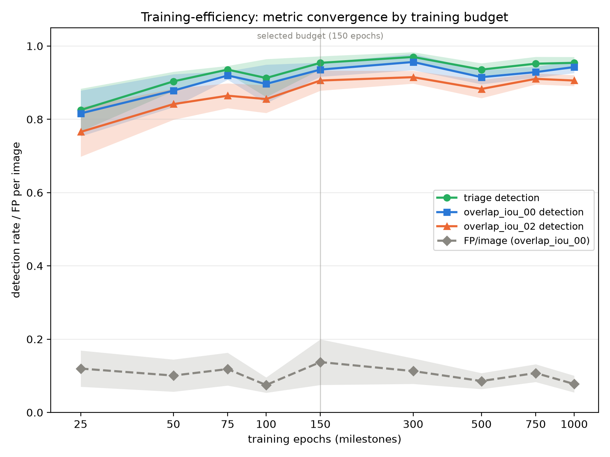

# Training-efficiency report

Training-efficiency experiment, dataset snapshot 2a91099919b6 (schema version 2). Detection rates are on malignant mass images (435 per checkpoint pool); FP/image is uncredited retained components per evaluated image at overlap_iou_00. Rates are mean ± sample SD across the five folds.

| epochs | triage detection | overlap_iou_02 detection | overlap_iou_00 detection | FP/image (overlap_iou_00) |
|---|---|---|---|---|
| 25 | 0.825 ± 0.058 (359/435) | 0.766 ± 0.067 (333/435) | 0.816 ± 0.062 (355/435) | 0.120 ± 0.049 |
| 50 | 0.903 ± 0.026 (393/435) | 0.841 ± 0.043 (366/435) | 0.878 ± 0.045 (382/435) | 0.101 ± 0.044 |
| 75 | 0.936 ± 0.010 (407/435) | 0.864 ± 0.034 (376/435) | 0.920 ± 0.011 (400/435) | 0.118 ± 0.045 |
| 100 | 0.913 ± 0.052 (397/435) | 0.855 ± 0.038 (372/435) | 0.897 ± 0.053 (390/435) | 0.075 ± 0.021 |
| **150** | **0.954 ± 0.018 (415/435)** | **0.906 ± 0.027 (394/435)** | **0.936 ± 0.019 (407/435)** | **0.137 ± 0.062** |
| 300 | 0.970 ± 0.013 (422/435) | 0.915 ± 0.017 (398/435) | 0.956 ± 0.022 (416/435) | 0.113 ± 0.035 |
| 500 | 0.936 ± 0.017 (407/435) | 0.883 ± 0.025 (384/435) | 0.915 ± 0.019 (398/435) | 0.086 ± 0.022 |
| 750 | 0.952 ± 0.019 (414/435) | 0.910 ± 0.015 (396/435) | 0.929 ± 0.015 (404/435) | 0.107 ± 0.024 |
| 1000 | 0.954 ± 0.016 (415/435) | 0.906 ± 0.015 (394/435) | 0.943 ± 0.016 (410/435) | 0.078 ± 0.023 |

Winner per the registered selection criterion (smallest budget whose malignant overlap_iou_00 detection rate is within 0.03 of the highest): **epoch 150** at 0.936, within 0.021 of the highest (epoch300, 0.956).
