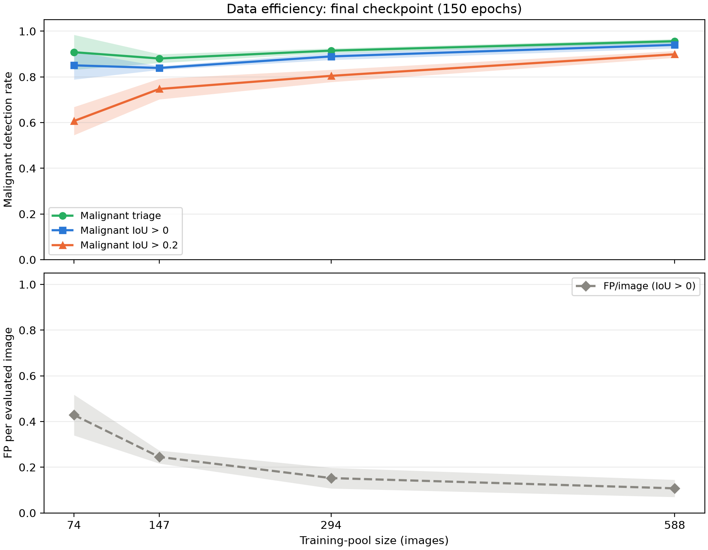
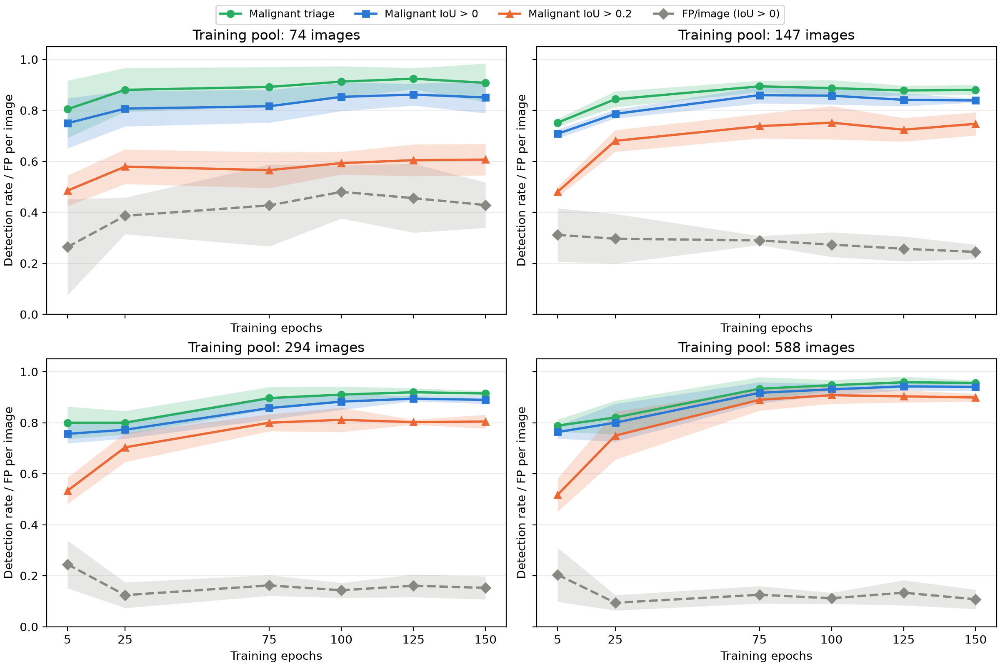

# Data-efficiency report

Dataset snapshot `cbed1239c12a` (schema 2); test split, seed 42, five fold models per training-pool size.

## Definitions and cohort

The same 147 unique test images (87 malignant, 40 benign, 20 normal) are evaluated by every model. Repeated model evaluations are not additional unique cases.

Training-pool sizes are 74, 147, 294 and 588 images; each fold trains on its training portion of that pool. Detection rates use only malignant images. Triage means any retained predicted mass component, regardless of location. Overlap detection requires at least one retained component with IoU strictly greater than 0 or 0.2 against the full reference mass mask.

FP/image (IoU > 0) counts retained components with no reference-mass overlap, divided by all evaluated images (malignant, benign and normal). Every retained component on a normal image is an FP. The normal-image flagged fraction is the fraction of normal images with any retained component; it is distinct from component FP/image.

Predictions use the shared 8-connected component filter with minimum area int(0.0003 × image area). Every table cell and shaded band is mean ± sample SD across five fold-model rates (SD denominator n−1). Models share the same test images and overlapping training data: this SD describes model variability, not independent patient uncertainty or a confidence interval. Bands are untruncated mean ± SD; axes start at zero.

## Final150 training-pool sweep

Fixed 150-epoch checkpoints provide the main size comparison. No winning-size selection rule is imposed.

| Training pool | Malignant triage | Malignant IoU > 0 | Malignant IoU > 0.2 | FP/image (IoU > 0) | Normal flagged fraction |
|---|---|---|---|---|---|
| 74 | 0.908 ± 0.076 | 0.851 ± 0.062 | 0.607 ± 0.062 | 0.429 ± 0.089 | 0.330 ± 0.097 |
| 147 | 0.880 ± 0.019 | 0.839 ± 0.008 | 0.747 ± 0.045 | 0.245 ± 0.028 | 0.270 ± 0.045 |
| 294 | 0.915 ± 0.010 | 0.890 ± 0.015 | 0.805 ± 0.027 | 0.152 ± 0.045 | 0.200 ± 0.071 |
| 588 | 0.956 ± 0.010 | 0.940 ± 0.015 | 0.899 ± 0.015 | 0.107 ± 0.038 | 0.150 ± 0.100 |

## Epoch trajectories

Archived epochs 5, 25, 75, 100 and 125 followed by final150; best checkpoints are excluded from these curves. Colors, markers and SD bands follow experiment01. The four panels use common axes.

## Best checkpoints (separate descriptive comparison)

Best checkpoints are selected by training-time validation, with potentially different epochs; they are not fixed-budget substitutes for final150.

| Training pool | Malignant triage | Malignant IoU > 0 | Malignant IoU > 0.2 | FP/image (IoU > 0) | Normal flagged fraction |
|---|---|---|---|---|---|
| 74 | 0.901 ± 0.055 | 0.844 ± 0.052 | 0.609 ± 0.059 | 0.442 ± 0.068 | 0.360 ± 0.096 |
| 147 | 0.892 ± 0.017 | 0.839 ± 0.022 | 0.747 ± 0.034 | 0.294 ± 0.029 | 0.320 ± 0.076 |
| 294 | 0.920 ± 0.014 | 0.894 ± 0.010 | 0.814 ± 0.022 | 0.158 ± 0.056 | 0.220 ± 0.097 |
| 588 | 0.961 ± 0.013 | 0.945 ± 0.005 | 0.908 ± 0.022 | 0.117 ± 0.047 | 0.190 ± 0.114 |

Best checkpoint epochs (folds 0–4): pool 74: 134, 125, 105, 146, 132; pool 147: 107, 62, 110, 136, 116; pool 294: 132, 147, 150, 150, 107; pool 588: 149, 145, 117, 135, 150.

Companion reports: [benign detection](../benign_detection_rates/benign_detection_rates.md), [segmentation](../segmentation_rates/segmentation_rates.md), and [full detection criteria](../detection_rates/detection_rates.md).
