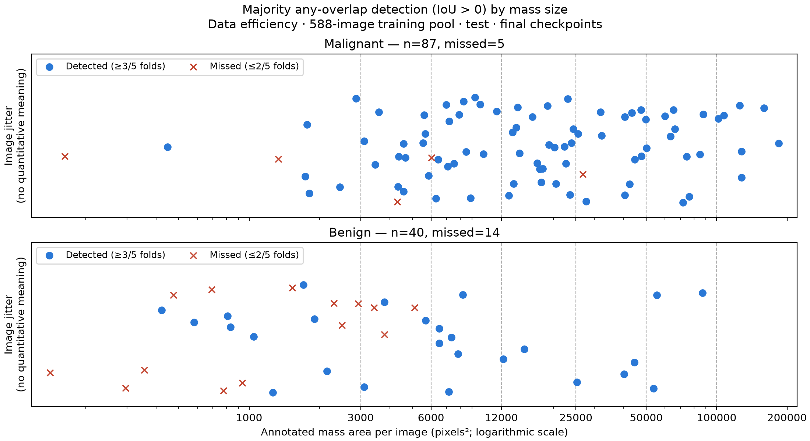
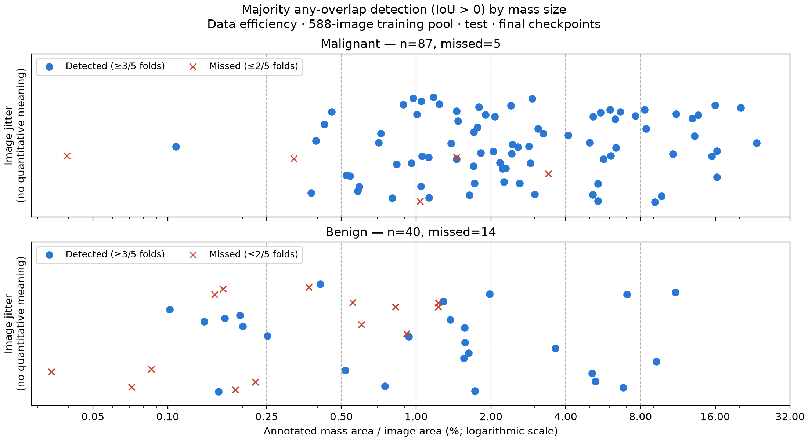

# Detection by fixed mass-area bins: 588-image pool

## Final — malignant

| Criterion | <3k | 3k–6k | 6k–12k | 12k–25k | 25k–50k | 50k–100k | 100k+ |
|---|---|---|---|---|---|---|---|
| **Unique images (n)** | **8** | **13** | **15** | **21** | **13** | **10** | **7** |
| presence | 0.850 ± 0.056 | 0.908 ± 0.084 | 0.907 ± 0.037 | 1.000 ± 0.000 | 1.000 ± 0.000 | 1.000 ± 0.000 | 1.000 ± 0.000 |
| overlap_iou_00 | 0.775 ± 0.105 | 0.908 ± 0.084 | 0.907 ± 0.037 | 1.000 ± 0.000 | 0.938 ± 0.034 | 1.000 ± 0.000 | 1.000 ± 0.000 |
| overlap_iou_02 | 0.650 ± 0.105 | 0.831 ± 0.064 | 0.880 ± 0.030 | 0.981 ± 0.026 | 0.908 ± 0.034 | 1.000 ± 0.000 | 0.943 ± 0.078 |
| overlap_iou_05 | 0.425 ± 0.143 | 0.585 ± 0.069 | 0.773 ± 0.060 | 0.905 ± 0.034 | 0.892 ± 0.042 | 1.000 ± 0.000 | 0.943 ± 0.078 |
| centroid_deq_025 | 0.550 ± 0.068 | 0.769 ± 0.109 | 0.800 ± 0.082 | 0.943 ± 0.040 | 0.908 ± 0.034 | 0.940 ± 0.055 | 0.943 ± 0.078 |
| centroid_deq_050 | 0.700 ± 0.068 | 0.892 ± 0.088 | 0.840 ± 0.037 | 0.962 ± 0.040 | 0.938 ± 0.034 | 1.000 ± 0.000 | 1.000 ± 0.000 |
| centroid_deq_100 | 0.725 ± 0.056 | 0.908 ± 0.084 | 0.907 ± 0.037 | 1.000 ± 0.000 | 0.938 ± 0.034 | 1.000 ± 0.000 | 1.000 ± 0.000 |

## Final — benign

| Criterion | <3k | 3k–6k | 6k–12k | 12k–25k | 25k–50k | 50k–100k | 100k+ |
|---|---|---|---|---|---|---|---|
| **Unique images (n)** | **20** | **6** | **6** | **2** | **3** | **3** | **0** |
| presence | 0.550 ± 0.100 | 0.733 ± 0.190 | 0.967 ± 0.075 | 1.000 ± 0.000 | 0.933 ± 0.149 | 1.000 ± 0.000 | NA |
| overlap_iou_00 | 0.440 ± 0.082 | 0.700 ± 0.217 | 0.967 ± 0.075 | 1.000 ± 0.000 | 0.933 ± 0.149 | 1.000 ± 0.000 | NA |
| overlap_iou_02 | 0.330 ± 0.045 | 0.533 ± 0.075 | 0.967 ± 0.075 | 1.000 ± 0.000 | 0.800 ± 0.298 | 1.000 ± 0.000 | NA |
| overlap_iou_05 | 0.220 ± 0.057 | 0.500 ± 0.118 | 0.800 ± 0.139 | 1.000 ± 0.000 | 0.533 ± 0.298 | 1.000 ± 0.000 | NA |
| centroid_deq_025 | 0.290 ± 0.065 | 0.600 ± 0.149 | 0.833 ± 0.118 | 1.000 ± 0.000 | 0.733 ± 0.279 | 0.933 ± 0.149 | NA |
| centroid_deq_050 | 0.400 ± 0.061 | 0.667 ± 0.167 | 0.867 ± 0.075 | 1.000 ± 0.000 | 0.933 ± 0.149 | 1.000 ± 0.000 | NA |
| centroid_deq_100 | 0.420 ± 0.067 | 0.733 ± 0.190 | 0.967 ± 0.075 | 1.000 ± 0.000 | 0.933 ± 0.149 | 1.000 ± 0.000 | NA |

Experiment 02; dataset snapshot `eb8bd31e22f0`; seed 42. 127 unique mass-positive test images (87 malignant, 40 benign); normals excluded.

Seven approximately logarithmic bins use `ground_truth_mass_area_px`: total annotated mass pixel area per image, not individual lesion or physical area. Bounds are lower inclusive and upper exclusive; image scale and cropping vary.

Rates are proportions (0–1), mean ± sample SD to three decimals across the five fold-trained models evaluated on the same images. SD describes model variation, not a confidence interval; repeated images are not additional independent cases. Empty bins are NA.

All seven existing image-level detection criteria and retained-component rules are reused: presence, overlap IoU > 0/0.2/0.5, and centroid equivalent-diameter tolerances 0.25/0.5/1.0. Presence need not localize the mass.

## Majority detection by image

Final checkpoints only; one point per mass-positive test image. Detected means any overlap (IoU > 0; `overlap_detection_iou_00_flag`) in at least 3 of 5 folds; circles are detected and crosses are missed. Vertical jitter is deterministic and has no quantitative meaning. Both panels share a logarithmic annotated-area axis; dashed lines mark the fixed-bin boundaries.

[PDF](detection_rates_by_size.pdf)

## Final — combined

| Criterion | 100k+ | 50k–100k | 25k–50k | 12k–25k | 6k–12k | 3k–6k | <3k |
|---|---|---|---|---|---|---|---|
| presence | 1.000 ± 0.000 | 1.000 ± 0.000 | 0.988 ± 0.028 | 1.000 ± 0.000 | 0.924 ± 0.026 | 0.853 ± 0.086 | 0.636 ± 0.069 |
| overlap_iou_00 | 1.000 ± 0.000 | 1.000 ± 0.000 | 0.938 ± 0.044 | 1.000 ± 0.000 | 0.924 ± 0.026 | 0.842 ± 0.083 | 0.536 ± 0.056 |
| overlap_iou_02 | 0.943 ± 0.078 | 1.000 ± 0.000 | 0.887 ± 0.081 | 0.983 ± 0.024 | 0.905 ± 0.034 | 0.737 ± 0.053 | 0.421 ± 0.053 |
| overlap_iou_05 | 0.943 ± 0.078 | 1.000 ± 0.000 | 0.825 ± 0.081 | 0.913 ± 0.031 | 0.781 ± 0.072 | 0.558 ± 0.080 | 0.279 ± 0.081 |
| centroid_deq_025 | 0.943 ± 0.078 | 0.938 ± 0.064 | 0.875 ± 0.077 | 0.948 ± 0.036 | 0.810 ± 0.058 | 0.716 ± 0.060 | 0.364 ± 0.059 |
| centroid_deq_050 | 1.000 ± 0.000 | 1.000 ± 0.000 | 0.938 ± 0.044 | 0.965 ± 0.036 | 0.848 ± 0.040 | 0.821 ± 0.060 | 0.486 ± 0.032 |
| centroid_deq_100 | 1.000 ± 0.000 | 1.000 ± 0.000 | 0.938 ± 0.044 | 1.000 ± 0.000 | 0.924 ± 0.026 | 0.853 ± 0.086 | 0.507 ± 0.047 |

## Best — malignant

| Criterion | <3k | 3k–6k | 6k–12k | 12k–25k | 25k–50k | 50k–100k | 100k+ |
|---|---|---|---|---|---|---|---|
| presence | 0.875 ± 0.088 | 0.923 ± 0.054 | 0.920 ± 0.056 | 1.000 ± 0.000 | 0.985 ± 0.034 | 1.000 ± 0.000 | 1.000 ± 0.000 |
| overlap_iou_00 | 0.800 ± 0.068 | 0.908 ± 0.064 | 0.920 ± 0.056 | 1.000 ± 0.000 | 0.938 ± 0.034 | 1.000 ± 0.000 | 1.000 ± 0.000 |
| overlap_iou_02 | 0.650 ± 0.137 | 0.846 ± 0.054 | 0.907 ± 0.060 | 0.990 ± 0.021 | 0.908 ± 0.034 | 1.000 ± 0.000 | 0.943 ± 0.078 |
| overlap_iou_05 | 0.425 ± 0.143 | 0.615 ± 0.077 | 0.800 ± 0.047 | 0.895 ± 0.071 | 0.892 ± 0.042 | 0.980 ± 0.045 | 0.943 ± 0.078 |
| centroid_deq_025 | 0.525 ± 0.105 | 0.785 ± 0.100 | 0.813 ± 0.056 | 0.933 ± 0.043 | 0.908 ± 0.034 | 0.920 ± 0.045 | 0.943 ± 0.078 |
| centroid_deq_050 | 0.700 ± 0.068 | 0.892 ± 0.088 | 0.853 ± 0.056 | 0.971 ± 0.026 | 0.938 ± 0.034 | 1.000 ± 0.000 | 1.000 ± 0.000 |
| centroid_deq_100 | 0.725 ± 0.056 | 0.908 ± 0.064 | 0.920 ± 0.056 | 1.000 ± 0.000 | 0.938 ± 0.034 | 1.000 ± 0.000 | 1.000 ± 0.000 |

## Best — benign

| Criterion | <3k | 3k–6k | 6k–12k | 12k–25k | 25k–50k | 50k–100k | 100k+ |
|---|---|---|---|---|---|---|---|
| presence | 0.600 ± 0.190 | 0.733 ± 0.190 | 0.967 ± 0.075 | 1.000 ± 0.000 | 0.933 ± 0.149 | 1.000 ± 0.000 | NA |
| overlap_iou_00 | 0.470 ± 0.144 | 0.733 ± 0.190 | 0.967 ± 0.075 | 1.000 ± 0.000 | 0.933 ± 0.149 | 1.000 ± 0.000 | NA |
| overlap_iou_02 | 0.380 ± 0.110 | 0.533 ± 0.075 | 0.967 ± 0.075 | 1.000 ± 0.000 | 0.800 ± 0.298 | 1.000 ± 0.000 | NA |
| overlap_iou_05 | 0.190 ± 0.074 | 0.533 ± 0.075 | 0.833 ± 0.118 | 1.000 ± 0.000 | 0.533 ± 0.298 | 1.000 ± 0.000 | NA |
| centroid_deq_025 | 0.340 ± 0.108 | 0.600 ± 0.149 | 0.833 ± 0.118 | 1.000 ± 0.000 | 0.733 ± 0.279 | 0.800 ± 0.183 | NA |
| centroid_deq_050 | 0.410 ± 0.119 | 0.667 ± 0.167 | 0.867 ± 0.075 | 1.000 ± 0.000 | 0.933 ± 0.149 | 1.000 ± 0.000 | NA |
| centroid_deq_100 | 0.440 ± 0.129 | 0.733 ± 0.190 | 0.967 ± 0.075 | 1.000 ± 0.000 | 0.933 ± 0.149 | 1.000 ± 0.000 | NA |

## Best — combined

| Criterion | 100k+ | 50k–100k | 25k–50k | 12k–25k | 6k–12k | 3k–6k | <3k |
|---|---|---|---|---|---|---|---|
| presence | 1.000 ± 0.000 | 1.000 ± 0.000 | 0.975 ± 0.034 | 1.000 ± 0.000 | 0.933 ± 0.026 | 0.863 ± 0.080 | 0.679 ± 0.145 |
| overlap_iou_00 | 1.000 ± 0.000 | 1.000 ± 0.000 | 0.938 ± 0.044 | 1.000 ± 0.000 | 0.933 ± 0.026 | 0.853 ± 0.069 | 0.564 ± 0.102 |
| overlap_iou_02 | 0.943 ± 0.078 | 1.000 ± 0.000 | 0.887 ± 0.081 | 0.991 ± 0.019 | 0.924 ± 0.026 | 0.747 ± 0.044 | 0.457 ± 0.108 |
| overlap_iou_05 | 0.943 ± 0.078 | 0.985 ± 0.034 | 0.825 ± 0.081 | 0.904 ± 0.064 | 0.810 ± 0.058 | 0.589 ± 0.069 | 0.257 ± 0.092 |
| centroid_deq_025 | 0.943 ± 0.078 | 0.892 ± 0.042 | 0.875 ± 0.077 | 0.939 ± 0.039 | 0.819 ± 0.062 | 0.726 ± 0.044 | 0.393 ± 0.091 |
| centroid_deq_050 | 1.000 ± 0.000 | 1.000 ± 0.000 | 0.938 ± 0.044 | 0.974 ± 0.024 | 0.857 ± 0.048 | 0.821 ± 0.060 | 0.493 ± 0.085 |
| centroid_deq_100 | 1.000 ± 0.000 | 1.000 ± 0.000 | 0.938 ± 0.044 | 1.000 ± 0.000 | 0.933 ± 0.026 | 0.853 ± 0.069 | 0.521 ± 0.090 |

## Detection by relative mass-area bins: 588-image pool

### Final — malignant

| Criterion | <0.25% | 0.25–0.5% | 0.5–1% | 1–2% | 2–4% | 4–8% | ≥8% |
|---|---|---|---|---|---|---|---|
| **Unique images (n)** | **2** | **5** | **11** | **22** | **18** | **14** | **15** |
| presence | 1.000 ± 0.000 | 0.760 ± 0.089 | 0.945 ± 0.081 | 0.909 ± 0.000 | 1.000 ± 0.000 | 1.000 ± 0.000 | 1.000 ± 0.000 |
| overlap_iou_00 | 0.700 ± 0.274 | 0.760 ± 0.089 | 0.945 ± 0.081 | 0.909 ± 0.000 | 0.956 ± 0.025 | 1.000 ± 0.000 | 1.000 ± 0.000 |
| overlap_iou_02 | 0.500 ± 0.000 | 0.760 ± 0.089 | 0.855 ± 0.165 | 0.864 ± 0.032 | 0.944 ± 0.000 | 0.957 ± 0.064 | 0.973 ± 0.037 |
| overlap_iou_05 | 0.400 ± 0.224 | 0.560 ± 0.089 | 0.709 ± 0.100 | 0.618 ± 0.069 | 0.944 ± 0.000 | 0.943 ± 0.060 | 0.973 ± 0.037 |
| centroid_deq_025 | 0.500 ± 0.000 | 0.560 ± 0.089 | 0.891 ± 0.149 | 0.718 ± 0.081 | 0.933 ± 0.025 | 0.943 ± 0.060 | 0.973 ± 0.037 |
| centroid_deq_050 | 0.500 ± 0.000 | 0.720 ± 0.110 | 0.945 ± 0.081 | 0.818 ± 0.056 | 0.956 ± 0.025 | 1.000 ± 0.000 | 1.000 ± 0.000 |
| centroid_deq_100 | 0.500 ± 0.000 | 0.760 ± 0.089 | 0.945 ± 0.081 | 0.909 ± 0.000 | 0.956 ± 0.025 | 1.000 ± 0.000 | 1.000 ± 0.000 |

### Final — benign

| Criterion | <0.25% | 0.25–0.5% | 0.5–1% | 1–2% | 2–4% | 4–8% | ≥8% |
|---|---|---|---|---|---|---|---|
| **Unique images (n)** | **13** | **3** | **7** | **10** | **1** | **4** | **2** |
| presence | 0.492 ± 0.088 | 0.667 ± 0.333 | 0.743 ± 0.064 | 0.860 ± 0.055 | 1.000 ± 0.000 | 1.000 ± 0.000 | 0.900 ± 0.224 |
| overlap_iou_00 | 0.431 ± 0.042 | 0.600 ± 0.279 | 0.543 ± 0.120 | 0.860 ± 0.055 | 1.000 ± 0.000 | 1.000 ± 0.000 | 0.900 ± 0.224 |
| overlap_iou_02 | 0.385 ± 0.000 | 0.467 ± 0.183 | 0.343 ± 0.128 | 0.780 ± 0.045 | 1.000 ± 0.000 | 0.900 ± 0.137 | 0.900 ± 0.224 |
| overlap_iou_05 | 0.262 ± 0.042 | 0.333 ± 0.236 | 0.229 ± 0.078 | 0.720 ± 0.130 | 1.000 ± 0.000 | 0.750 ± 0.177 | 0.800 ± 0.274 |
| centroid_deq_025 | 0.354 ± 0.042 | 0.333 ± 0.408 | 0.286 ± 0.101 | 0.780 ± 0.110 | 1.000 ± 0.000 | 0.800 ± 0.209 | 0.900 ± 0.224 |
| centroid_deq_050 | 0.400 ± 0.034 | 0.600 ± 0.279 | 0.371 ± 0.128 | 0.860 ± 0.055 | 1.000 ± 0.000 | 1.000 ± 0.000 | 0.900 ± 0.224 |
| centroid_deq_100 | 0.400 ± 0.034 | 0.600 ± 0.279 | 0.571 ± 0.101 | 0.860 ± 0.055 | 1.000 ± 0.000 | 1.000 ± 0.000 | 0.900 ± 0.224 |

Experiment 02; dataset snapshot `eb8bd31e22f0`; seed 42. 127 unique mass-positive test images (87 malignant, 40 benign); normals excluded.

Seven approximately logarithmic bins use relative mass area (%): `100 × ground_truth_mass_area_px / (image_height_px × image_width_px)`. This is total annotated mass area per image, not individual lesion or physical area. Bounds are lower inclusive and upper exclusive. Normalization accounts for proportional resizing, but not cropping, borders, or acquisition magnification. Thresholds are shared across pathologies, checkpoints, and folds and were selected without detection outcomes. Some benign bins contain very few images; interpret their rates alongside the counts.

Rates are proportions (0–1), mean ± sample SD to three decimals across the five fold-trained models evaluated on the same images. SD describes model variation, not a confidence interval; repeated images are not additional independent cases. Empty bins are NA.

All seven existing image-level detection criteria and retained-component rules are reused: presence, overlap IoU > 0/0.2/0.5, and centroid equivalent-diameter tolerances 0.25/0.5/1.0. Presence need not localize the mass.

### Majority detection by image

Final checkpoints only; one point per mass-positive test image. Detected means any overlap (IoU > 0; `overlap_detection_iou_00_flag`) in at least 3 of 5 folds; circles are detected and crosses are missed. Vertical jitter is deterministic and has no quantitative meaning. Both panels share a logarithmic relative-area (%) axis; dashed lines mark the fixed-bin boundaries.

[PDF](detection_rates_by_relative_size.pdf)

### Final — combined

| Criterion | ≥8% | 4–8% | 2–4% | 1–2% | 0.5–1% | 0.25–0.5% | <0.25% |
|---|---|---|---|---|---|---|---|
| presence | 0.988 ± 0.026 | 1.000 ± 0.000 | 1.000 ± 0.000 | 0.894 ± 0.017 | 0.867 ± 0.063 | 0.725 ± 0.163 | 0.560 ± 0.076 |
| overlap_iou_00 | 0.988 ± 0.026 | 1.000 ± 0.000 | 0.958 ± 0.024 | 0.894 ± 0.017 | 0.789 ± 0.061 | 0.700 ± 0.143 | 0.467 ± 0.047 |
| overlap_iou_02 | 0.965 ± 0.032 | 0.944 ± 0.068 | 0.947 ± 0.000 | 0.838 ± 0.026 | 0.656 ± 0.120 | 0.650 ± 0.105 | 0.400 ± 0.000 |
| overlap_iou_05 | 0.953 ± 0.026 | 0.900 ± 0.072 | 0.947 ± 0.000 | 0.650 ± 0.064 | 0.522 ± 0.084 | 0.475 ± 0.105 | 0.280 ± 0.056 |
| centroid_deq_025 | 0.965 ± 0.032 | 0.911 ± 0.084 | 0.937 ± 0.024 | 0.738 ± 0.036 | 0.656 ± 0.072 | 0.475 ± 0.163 | 0.373 ± 0.037 |
| centroid_deq_050 | 0.988 ± 0.026 | 1.000 ± 0.000 | 0.958 ± 0.024 | 0.831 ± 0.036 | 0.722 ± 0.039 | 0.675 ± 0.143 | 0.413 ± 0.030 |
| centroid_deq_100 | 0.988 ± 0.026 | 1.000 ± 0.000 | 0.958 ± 0.024 | 0.894 ± 0.017 | 0.800 ± 0.063 | 0.700 ± 0.143 | 0.413 ± 0.030 |

### Best — malignant

| Criterion | <0.25% | 0.25–0.5% | 0.5–1% | 1–2% | 2–4% | 4–8% | ≥8% |
|---|---|---|---|---|---|---|---|
| presence | 1.000 ± 0.000 | 0.800 ± 0.141 | 0.964 ± 0.050 | 0.918 ± 0.020 | 0.989 ± 0.025 | 1.000 ± 0.000 | 1.000 ± 0.000 |
| overlap_iou_00 | 0.800 ± 0.274 | 0.760 ± 0.089 | 0.945 ± 0.081 | 0.918 ± 0.020 | 0.956 ± 0.025 | 1.000 ± 0.000 | 1.000 ± 0.000 |
| overlap_iou_02 | 0.500 ± 0.000 | 0.760 ± 0.089 | 0.873 ± 0.138 | 0.882 ± 0.052 | 0.944 ± 0.000 | 0.971 ± 0.039 | 0.973 ± 0.037 |
| overlap_iou_05 | 0.500 ± 0.000 | 0.560 ± 0.089 | 0.709 ± 0.100 | 0.645 ± 0.075 | 0.933 ± 0.025 | 0.929 ± 0.087 | 0.973 ± 0.037 |
| centroid_deq_025 | 0.500 ± 0.000 | 0.560 ± 0.089 | 0.891 ± 0.149 | 0.718 ± 0.075 | 0.933 ± 0.025 | 0.929 ± 0.051 | 0.973 ± 0.037 |
| centroid_deq_050 | 0.500 ± 0.000 | 0.720 ± 0.110 | 0.945 ± 0.081 | 0.836 ± 0.052 | 0.956 ± 0.025 | 1.000 ± 0.000 | 1.000 ± 0.000 |
| centroid_deq_100 | 0.500 ± 0.000 | 0.760 ± 0.089 | 0.945 ± 0.081 | 0.918 ± 0.020 | 0.956 ± 0.025 | 1.000 ± 0.000 | 1.000 ± 0.000 |

### Best — benign

| Criterion | <0.25% | 0.25–0.5% | 0.5–1% | 1–2% | 2–4% | 4–8% | ≥8% |
|---|---|---|---|---|---|---|---|
| presence | 0.554 ± 0.175 | 0.733 ± 0.365 | 0.771 ± 0.128 | 0.840 ± 0.089 | 1.000 ± 0.000 | 1.000 ± 0.000 | 0.900 ± 0.224 |
| overlap_iou_00 | 0.446 ± 0.126 | 0.667 ± 0.333 | 0.629 ± 0.128 | 0.840 ± 0.089 | 1.000 ± 0.000 | 1.000 ± 0.000 | 0.900 ± 0.224 |
| overlap_iou_02 | 0.400 ± 0.064 | 0.600 ± 0.279 | 0.371 ± 0.128 | 0.800 ± 0.071 | 1.000 ± 0.000 | 0.900 ± 0.137 | 0.900 ± 0.224 |
| overlap_iou_05 | 0.215 ± 0.084 | 0.333 ± 0.333 | 0.229 ± 0.078 | 0.760 ± 0.055 | 1.000 ± 0.000 | 0.750 ± 0.177 | 0.800 ± 0.274 |
| centroid_deq_025 | 0.369 ± 0.084 | 0.533 ± 0.380 | 0.286 ± 0.000 | 0.800 ± 0.100 | 1.000 ± 0.000 | 0.700 ± 0.112 | 0.900 ± 0.224 |
| centroid_deq_050 | 0.400 ± 0.064 | 0.667 ± 0.333 | 0.400 ± 0.120 | 0.840 ± 0.089 | 1.000 ± 0.000 | 1.000 ± 0.000 | 0.900 ± 0.224 |
| centroid_deq_100 | 0.400 ± 0.064 | 0.667 ± 0.333 | 0.629 ± 0.128 | 0.840 ± 0.089 | 1.000 ± 0.000 | 1.000 ± 0.000 | 0.900 ± 0.224 |

### Best — combined

| Criterion | ≥8% | 4–8% | 2–4% | 1–2% | 0.5–1% | 0.25–0.5% | <0.25% |
|---|---|---|---|---|---|---|---|
| presence | 0.988 ± 0.026 | 1.000 ± 0.000 | 0.989 ± 0.024 | 0.894 ± 0.017 | 0.889 ± 0.079 | 0.775 ± 0.163 | 0.613 ± 0.152 |
| overlap_iou_00 | 0.988 ± 0.026 | 1.000 ± 0.000 | 0.958 ± 0.024 | 0.894 ± 0.017 | 0.822 ± 0.091 | 0.725 ± 0.137 | 0.493 ± 0.101 |
| overlap_iou_02 | 0.965 ± 0.032 | 0.956 ± 0.046 | 0.947 ± 0.000 | 0.856 ± 0.028 | 0.678 ± 0.114 | 0.700 ± 0.112 | 0.413 ± 0.056 |
| overlap_iou_05 | 0.953 ± 0.026 | 0.889 ± 0.096 | 0.937 ± 0.024 | 0.681 ± 0.051 | 0.522 ± 0.084 | 0.475 ± 0.105 | 0.253 ± 0.073 |
| centroid_deq_025 | 0.965 ± 0.032 | 0.878 ± 0.046 | 0.937 ± 0.024 | 0.744 ± 0.041 | 0.656 ± 0.091 | 0.550 ± 0.143 | 0.387 ± 0.073 |
| centroid_deq_050 | 0.988 ± 0.026 | 1.000 ± 0.000 | 0.958 ± 0.024 | 0.838 ± 0.026 | 0.733 ± 0.091 | 0.700 ± 0.168 | 0.413 ± 0.056 |
| centroid_deq_100 | 0.988 ± 0.026 | 1.000 ± 0.000 | 0.958 ± 0.024 | 0.894 ± 0.017 | 0.822 ± 0.091 | 0.725 ± 0.137 | 0.413 ± 0.056 |
