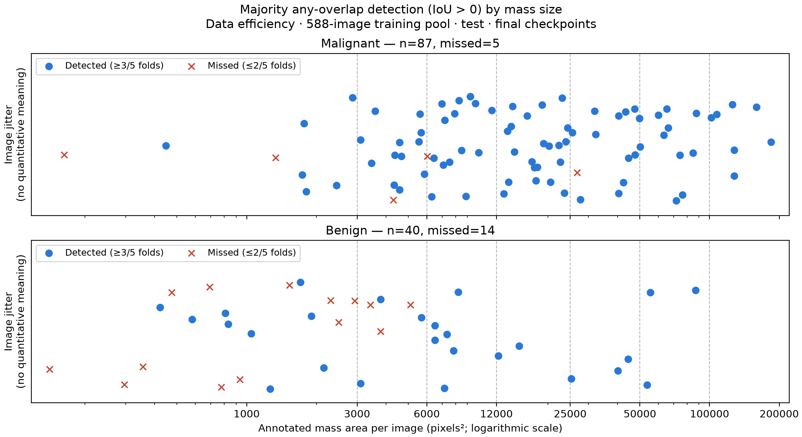

# Detection by fixed mass-area bins: 588-image pool

Any-overlap detection: adjusted logistic regression using continuous mass pixel area.

| Checkpoint | Size: adjusted odds ratio per doubling (95% CI) | Malignant vs benign: adjusted odds ratio (95% CI) |
|---|---|---|
| Final | 1.86 (1.48–2.35) | 2.75 (1.02–7.42) |
| Best | 1.83 (1.46–2.29) | 2.78 (1.02–7.58) |

For the complete charts, see below.

Experiment 02; dataset snapshot `9266764b0e11`; seed 42. 127 unique mass-positive test images (87 malignant, 40 benign); normals excluded.

Seven approximately logarithmic bins use `ground_truth_mass_area_px`: total annotated mass pixel area per image, not individual lesion or physical area. Bounds are lower inclusive and upper exclusive; image scale and cropping vary.

Rates are percentages, mean ± sample SD across the five fold-trained models evaluated on the same images. SD describes model variation, not a confidence interval; repeated images are not additional independent cases. Empty bins are NA.

All seven existing image-level detection criteria and retained-component rules are reused: presence, overlap IoU > 0/0.2/0.5, and centroid equivalent-diameter tolerances 0.25/0.5/1.0. Presence need not localize the mass.

## Unique image counts

| Pixel-area bin | Malignant | Benign | Combined |
|---|---|---|---|
| 100k+ | 7 | 0 | 7 |
| 50k–100k | 10 | 3 | 13 |
| 25k–50k | 13 | 3 | 16 |
| 12k–25k | 21 | 2 | 23 |
| 6k–12k | 15 | 6 | 21 |
| 3k–6k | 13 | 6 | 19 |
| <3k | 8 | 20 | 28 |

## Majority detection by image

Final checkpoints only; one point per mass-positive test image. Detected means any overlap (IoU > 0; `overlap_detection_iou_00_flag`) in at least 3 of 5 folds; circles are detected and crosses are missed. Vertical jitter is deterministic and has no quantitative meaning. Both panels share a logarithmic annotated-area axis; dashed lines mark the fixed-bin boundaries.

[SVG](majority_detection_by_size.svg) · [Image vote counts](majority_detection_by_size.csv)

## Final — malignant

| Criterion | 100k+ | 50k–100k | 25k–50k | 12k–25k | 6k–12k | 3k–6k | <3k |
|---|---|---|---|---|---|---|---|
| presence | 100.0 ± 0.0 | 100.0 ± 0.0 | 100.0 ± 0.0 | 100.0 ± 0.0 | 90.7 ± 3.7 | 90.8 ± 8.4 | 85.0 ± 5.6 |
| overlap_iou_00 | 100.0 ± 0.0 | 100.0 ± 0.0 | 93.8 ± 3.4 | 100.0 ± 0.0 | 90.7 ± 3.7 | 90.8 ± 8.4 | 77.5 ± 10.5 |
| overlap_iou_02 | 94.3 ± 7.8 | 100.0 ± 0.0 | 90.8 ± 3.4 | 98.1 ± 2.6 | 88.0 ± 3.0 | 83.1 ± 6.4 | 65.0 ± 10.5 |
| overlap_iou_05 | 94.3 ± 7.8 | 100.0 ± 0.0 | 89.2 ± 4.2 | 90.5 ± 3.4 | 77.3 ± 6.0 | 58.5 ± 6.9 | 42.5 ± 14.3 |
| centroid_deq_025 | 94.3 ± 7.8 | 94.0 ± 5.5 | 90.8 ± 3.4 | 94.3 ± 4.0 | 80.0 ± 8.2 | 76.9 ± 10.9 | 55.0 ± 6.8 |
| centroid_deq_050 | 100.0 ± 0.0 | 100.0 ± 0.0 | 93.8 ± 3.4 | 96.2 ± 4.0 | 84.0 ± 3.7 | 89.2 ± 8.8 | 70.0 ± 6.8 |
| centroid_deq_100 | 100.0 ± 0.0 | 100.0 ± 0.0 | 93.8 ± 3.4 | 100.0 ± 0.0 | 90.7 ± 3.7 | 90.8 ± 8.4 | 72.5 ± 5.6 |

## Final — benign

| Criterion | 100k+ | 50k–100k | 25k–50k | 12k–25k | 6k–12k | 3k–6k | <3k |
|---|---|---|---|---|---|---|---|
| presence | NA | 100.0 ± 0.0 | 93.3 ± 14.9 | 100.0 ± 0.0 | 96.7 ± 7.5 | 73.3 ± 19.0 | 55.0 ± 10.0 |
| overlap_iou_00 | NA | 100.0 ± 0.0 | 93.3 ± 14.9 | 100.0 ± 0.0 | 96.7 ± 7.5 | 70.0 ± 21.7 | 44.0 ± 8.2 |
| overlap_iou_02 | NA | 100.0 ± 0.0 | 80.0 ± 29.8 | 100.0 ± 0.0 | 96.7 ± 7.5 | 53.3 ± 7.5 | 33.0 ± 4.5 |
| overlap_iou_05 | NA | 100.0 ± 0.0 | 53.3 ± 29.8 | 100.0 ± 0.0 | 80.0 ± 13.9 | 50.0 ± 11.8 | 22.0 ± 5.7 |
| centroid_deq_025 | NA | 93.3 ± 14.9 | 73.3 ± 27.9 | 100.0 ± 0.0 | 83.3 ± 11.8 | 60.0 ± 14.9 | 29.0 ± 6.5 |
| centroid_deq_050 | NA | 100.0 ± 0.0 | 93.3 ± 14.9 | 100.0 ± 0.0 | 86.7 ± 7.5 | 66.7 ± 16.7 | 40.0 ± 6.1 |
| centroid_deq_100 | NA | 100.0 ± 0.0 | 93.3 ± 14.9 | 100.0 ± 0.0 | 96.7 ± 7.5 | 73.3 ± 19.0 | 42.0 ± 6.7 |

## Final — combined

| Criterion | 100k+ | 50k–100k | 25k–50k | 12k–25k | 6k–12k | 3k–6k | <3k |
|---|---|---|---|---|---|---|---|
| presence | 100.0 ± 0.0 | 100.0 ± 0.0 | 98.8 ± 2.8 | 100.0 ± 0.0 | 92.4 ± 2.6 | 85.3 ± 8.6 | 63.6 ± 6.9 |
| overlap_iou_00 | 100.0 ± 0.0 | 100.0 ± 0.0 | 93.8 ± 4.4 | 100.0 ± 0.0 | 92.4 ± 2.6 | 84.2 ± 8.3 | 53.6 ± 5.6 |
| overlap_iou_02 | 94.3 ± 7.8 | 100.0 ± 0.0 | 88.8 ± 8.1 | 98.3 ± 2.4 | 90.5 ± 3.4 | 73.7 ± 5.3 | 42.1 ± 5.3 |
| overlap_iou_05 | 94.3 ± 7.8 | 100.0 ± 0.0 | 82.5 ± 8.1 | 91.3 ± 3.1 | 78.1 ± 7.2 | 55.8 ± 8.0 | 27.9 ± 8.1 |
| centroid_deq_025 | 94.3 ± 7.8 | 93.8 ± 6.4 | 87.5 ± 7.7 | 94.8 ± 3.6 | 81.0 ± 5.8 | 71.6 ± 6.0 | 36.4 ± 5.9 |
| centroid_deq_050 | 100.0 ± 0.0 | 100.0 ± 0.0 | 93.8 ± 4.4 | 96.5 ± 3.6 | 84.8 ± 4.0 | 82.1 ± 6.0 | 48.6 ± 3.2 |
| centroid_deq_100 | 100.0 ± 0.0 | 100.0 ± 0.0 | 93.8 ± 4.4 | 100.0 ± 0.0 | 92.4 ± 2.6 | 85.3 ± 8.6 | 50.7 ± 4.7 |

## Best — malignant

| Criterion | 100k+ | 50k–100k | 25k–50k | 12k–25k | 6k–12k | 3k–6k | <3k |
|---|---|---|---|---|---|---|---|
| presence | 100.0 ± 0.0 | 100.0 ± 0.0 | 98.5 ± 3.4 | 100.0 ± 0.0 | 92.0 ± 5.6 | 92.3 ± 5.4 | 87.5 ± 8.8 |
| overlap_iou_00 | 100.0 ± 0.0 | 100.0 ± 0.0 | 93.8 ± 3.4 | 100.0 ± 0.0 | 92.0 ± 5.6 | 90.8 ± 6.4 | 80.0 ± 6.8 |
| overlap_iou_02 | 94.3 ± 7.8 | 100.0 ± 0.0 | 90.8 ± 3.4 | 99.0 ± 2.1 | 90.7 ± 6.0 | 84.6 ± 5.4 | 65.0 ± 13.7 |
| overlap_iou_05 | 94.3 ± 7.8 | 98.0 ± 4.5 | 89.2 ± 4.2 | 89.5 ± 7.1 | 80.0 ± 4.7 | 61.5 ± 7.7 | 42.5 ± 14.3 |
| centroid_deq_025 | 94.3 ± 7.8 | 92.0 ± 4.5 | 90.8 ± 3.4 | 93.3 ± 4.3 | 81.3 ± 5.6 | 78.5 ± 10.0 | 52.5 ± 10.5 |
| centroid_deq_050 | 100.0 ± 0.0 | 100.0 ± 0.0 | 93.8 ± 3.4 | 97.1 ± 2.6 | 85.3 ± 5.6 | 89.2 ± 8.8 | 70.0 ± 6.8 |
| centroid_deq_100 | 100.0 ± 0.0 | 100.0 ± 0.0 | 93.8 ± 3.4 | 100.0 ± 0.0 | 92.0 ± 5.6 | 90.8 ± 6.4 | 72.5 ± 5.6 |

## Best — benign

| Criterion | 100k+ | 50k–100k | 25k–50k | 12k–25k | 6k–12k | 3k–6k | <3k |
|---|---|---|---|---|---|---|---|
| presence | NA | 100.0 ± 0.0 | 93.3 ± 14.9 | 100.0 ± 0.0 | 96.7 ± 7.5 | 73.3 ± 19.0 | 60.0 ± 19.0 |
| overlap_iou_00 | NA | 100.0 ± 0.0 | 93.3 ± 14.9 | 100.0 ± 0.0 | 96.7 ± 7.5 | 73.3 ± 19.0 | 47.0 ± 14.4 |
| overlap_iou_02 | NA | 100.0 ± 0.0 | 80.0 ± 29.8 | 100.0 ± 0.0 | 96.7 ± 7.5 | 53.3 ± 7.5 | 38.0 ± 11.0 |
| overlap_iou_05 | NA | 100.0 ± 0.0 | 53.3 ± 29.8 | 100.0 ± 0.0 | 83.3 ± 11.8 | 53.3 ± 7.5 | 19.0 ± 7.4 |
| centroid_deq_025 | NA | 80.0 ± 18.3 | 73.3 ± 27.9 | 100.0 ± 0.0 | 83.3 ± 11.8 | 60.0 ± 14.9 | 34.0 ± 10.8 |
| centroid_deq_050 | NA | 100.0 ± 0.0 | 93.3 ± 14.9 | 100.0 ± 0.0 | 86.7 ± 7.5 | 66.7 ± 16.7 | 41.0 ± 11.9 |
| centroid_deq_100 | NA | 100.0 ± 0.0 | 93.3 ± 14.9 | 100.0 ± 0.0 | 96.7 ± 7.5 | 73.3 ± 19.0 | 44.0 ± 12.9 |

## Best — combined

| Criterion | 100k+ | 50k–100k | 25k–50k | 12k–25k | 6k–12k | 3k–6k | <3k |
|---|---|---|---|---|---|---|---|
| presence | 100.0 ± 0.0 | 100.0 ± 0.0 | 97.5 ± 3.4 | 100.0 ± 0.0 | 93.3 ± 2.6 | 86.3 ± 8.0 | 67.9 ± 14.5 |
| overlap_iou_00 | 100.0 ± 0.0 | 100.0 ± 0.0 | 93.8 ± 4.4 | 100.0 ± 0.0 | 93.3 ± 2.6 | 85.3 ± 6.9 | 56.4 ± 10.2 |
| overlap_iou_02 | 94.3 ± 7.8 | 100.0 ± 0.0 | 88.8 ± 8.1 | 99.1 ± 1.9 | 92.4 ± 2.6 | 74.7 ± 4.4 | 45.7 ± 10.8 |
| overlap_iou_05 | 94.3 ± 7.8 | 98.5 ± 3.4 | 82.5 ± 8.1 | 90.4 ± 6.4 | 81.0 ± 5.8 | 58.9 ± 6.9 | 25.7 ± 9.2 |
| centroid_deq_025 | 94.3 ± 7.8 | 89.2 ± 4.2 | 87.5 ± 7.7 | 93.9 ± 3.9 | 81.9 ± 6.2 | 72.6 ± 4.4 | 39.3 ± 9.1 |
| centroid_deq_050 | 100.0 ± 0.0 | 100.0 ± 0.0 | 93.8 ± 4.4 | 97.4 ± 2.4 | 85.7 ± 4.8 | 82.1 ± 6.0 | 49.3 ± 8.5 |
| centroid_deq_100 | 100.0 ± 0.0 | 100.0 ± 0.0 | 93.8 ± 4.4 | 100.0 ± 0.0 | 93.3 ± 2.6 | 85.3 ± 6.9 | 52.1 ± 9.0 |

## Continuous-size and pathology regression

All 127 images, without a size threshold: 635 predictions and 127 image clusters per checkpoint. OR = odds ratio; CI = cluster-robust 95% Wald confidence interval. This absolute-pixel-area regression is independent of the displayed bins; it is not a separate relative-area regression.

### Final

| Criterion | Adjusted size OR (95% CI), per doubling | p | Adjusted malignant vs benign OR (95% CI) | p |
|---|---|---|---|---|
| presence | 1.82 (1.41–2.33) | 2.95e-06 | 2.87 (0.82–10.08) | 0.0992 |
| overlap_iou_00 | 1.86 (1.48–2.35) | 1.19e-07 | 2.75 (1.02–7.42) | 0.0464 |
| overlap_iou_02 | 1.70 (1.37–2.12) | 2.17e-06 | 2.65 (1.11–6.31) | 0.0281 |
| overlap_iou_05 | 1.80 (1.45–2.24) | 1.2e-07 | 1.70 (0.73–3.98) | 0.217 |
| centroid_deq_025 | 1.65 (1.35–2.01) | 7.17e-07 | 2.04 (0.93–4.44) | 0.0736 |
| centroid_deq_050 | 1.82 (1.45–2.28) | 1.99e-07 | 2.14 (0.85–5.36) | 0.105 |
| centroid_deq_100 | 1.98 (1.52–2.59) | 4.67e-07 | 2.38 (0.86–6.58) | 0.0933 |

### Best

| Criterion | Adjusted size OR (95% CI), per doubling | p | Adjusted malignant vs benign OR (95% CI) | p |
|---|---|---|---|---|
| presence | 1.71 (1.37–2.13) | 1.76e-06 | 3.09 (0.96–9.90) | 0.0581 |
| overlap_iou_00 | 1.83 (1.46–2.29) | 1.92e-07 | 2.78 (1.02–7.58) | 0.046 |
| overlap_iou_02 | 1.72 (1.38–2.14) | 1.33e-06 | 2.60 (1.08–6.22) | 0.0325 |
| overlap_iou_05 | 1.82 (1.45–2.28) | 2.58e-07 | 1.80 (0.76–4.26) | 0.183 |
| centroid_deq_025 | 1.57 (1.30–1.92) | 5.3e-06 | 1.99 (0.90–4.44) | 0.0912 |
| centroid_deq_050 | 1.84 (1.47–2.29) | 9.4e-08 | 2.21 (0.88–5.59) | 0.0927 |
| centroid_deq_100 | 2.00 (1.53–2.61) | 2.97e-07 | 2.34 (0.85–6.45) | 0.1 |

Methods: Separate unpenalized logistic maximum-likelihood fits for each checkpoint and criterion use the binary detection outcome, an intercept, centered continuous log2 ground-truth mass pixel area (not bins), malignant indicator (benign reference), and fold fixed effects 1–4 (fold 0 reference). Both reported ORs are mutually adjusted and adjusted for fold. The model assumes additive log-linear effects without interaction. Pixel area is not physical size. Image-cluster sandwich covariance uses the finite-sample correction G/(G−1) × (N−1)/(N−K), with G=127, N=635, K=7. Clusters represent the same images conditional on these five trained models, not uncertainty from retraining. Associations are not causal; OR magnitudes cannot be compared as variance contributions or fractions of detection explained. Wald uncertainty is approximate; p values are exploratory with no multiple-testing adjustment. Nonconvergence, separation, or singular information yields an unavailable fit with its reason. Coefficients and robust standard errors for all terms are saved in `detection_rates_by_size_bins_regression.csv`.
