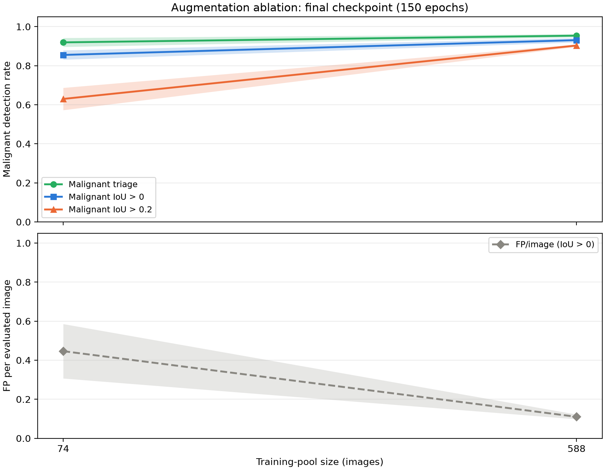

# Augmentation-ablation report

Dataset snapshot `b63d4754f920` (schema 2); test split, seed 42, five fold models per training-pool size.

With brightness-augmentation probability increased from 0.15 to 0.5, models trained on pools of 74 and 588 images are evaluated on the same 147 test images for malignant detection and false positives, reported as mean ± sample SD across five fold models.

## Final150 training-pool sweep

Fixed 150-epoch checkpoints provide the main size comparison. No winning-size selection rule is imposed.

| Training pool | Malignant triage | Malignant IoU > 0 | Malignant IoU > 0.2 | FP/image (IoU > 0) | Normal flagged fraction |
|---|---|---|---|---|---|
| 74 | 0.920 ± 0.023 | 0.855 ± 0.024 | 0.630 ± 0.057 | 0.446 ± 0.139 | 0.430 ± 0.175 |
| 588 | 0.954 ± 0.008 | 0.931 ± 0.011 | 0.903 ± 0.006 | 0.110 ± 0.012 | 0.120 ± 0.027 |

## Best checkpoints (separate descriptive comparison)

Best checkpoints are selected by training-time validation, with potentially different epochs; they are not fixed-budget substitutes for final150.

| Training pool | Malignant triage | Malignant IoU > 0 | Malignant IoU > 0.2 | FP/image (IoU > 0) | Normal flagged fraction |
|---|---|---|---|---|---|
| 74 | 0.926 ± 0.019 | 0.867 ± 0.021 | 0.625 ± 0.066 | 0.450 ± 0.143 | 0.450 ± 0.154 |
| 588 | 0.959 ± 0.006 | 0.936 ± 0.015 | 0.901 ± 0.010 | 0.103 ± 0.025 | 0.130 ± 0.027 |

Best checkpoint epochs (folds 0–4): pool 74: 150, 111, 138, 149, 125; pool 588: 150, 146, 150, 131, 147.

Companion reports: [detection rates](../detection_rates/detection_rates.md) and [segmentation](../segmentation_rates/segmentation_rates.md).
