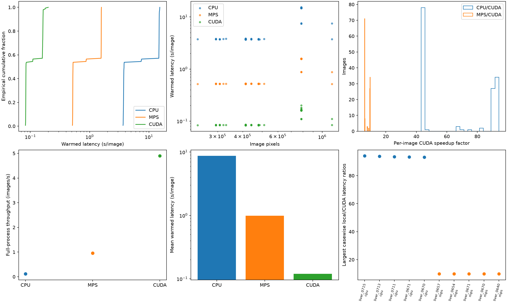
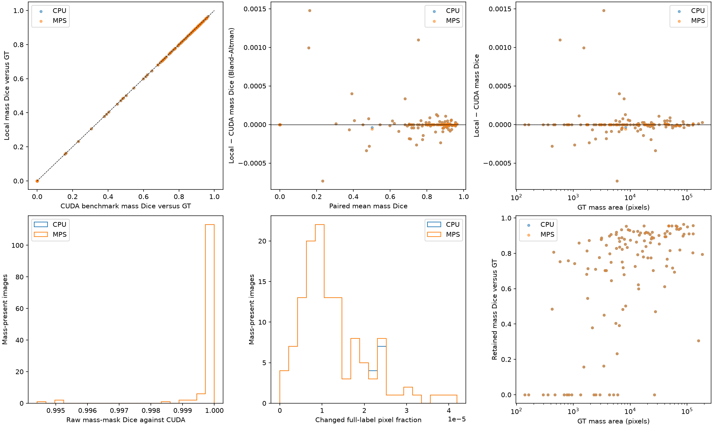

# Experiment 05: local CPU/MPS versus archived CUDA

Dataset snapshot: `9266764b0e11`. Same pool-588, seed-42, fold-4, final/150-epoch model; 147 held-out images (87 malignant, 40 benign, 20 normal). No ensemble or retraining.

CPU/MPS: Apple M1 Pro, 32 GiB shared RAM. CUDA: NVIDIA RTX 6000 Ada Generation, AMD EPYC 7443 24-Core Processor host. Hardware, OS, software and hosts differ: this compares systems/backends, not isolated device effects. Full settings are in `hardware_comparison.json`.

## Performance

| System/backend | Estimated GPU price (US$) | Mean latency (s) | Median (s) | p95 (s) | p99 (s) | Batch wall mean ± SD (s) | Images/s | Batch repeats |
|---|---:|---:|---:|---:|---:|---:|---:|---:|
| CPU | — | 8.700909 | 3.812162 | 15.000152 | 15.255345 | 1299.092 ± 3.139 | 0.113 | 3 |
| MPS | $200–$400 | 0.988459 | 0.524532 | 1.575558 | 1.579984 | 154.117 ± 0.097 | 0.954 | 3 |
| CUDA | $8,000–$9,600 | 0.119421 | 0.084622 | 0.164575 | 0.178827 | 30.024 ± unavailable | 4.896 | 1 |

Latency covers warmed predictor calls, including CPU accumulation and host-device transfers—not initialization, preprocessing or export. Batch wall time includes startup, loading, preprocessing and mask export; SD reflects run-to-run variability.

- CUDA versus CPU: 72.86× mean-latency speedup; 43.27× full-process throughput.
- CUDA versus MPS: 8.28× mean-latency speedup; 5.13× full-process throughput.
- MPS versus CPU: 8.80× mean-latency speedup; 8.43× full-process throughput.

| Backend | Process-cold first-case seconds | Pixel-count/latency Spearman ρ | Log–log size slope |
|---|---:|---:|---:|
| CPU | 13.008 | 0.763 | 1.723 |
| MPS | 9.258 | 0.781 | 1.377 |
| CUDA | not measured | 0.795 | 0.825 |

| Backend | Parent lifetime high-water RSS (MiB) | Peak CUDA allocation (MiB) | Sampled batch-child RSS |
|---|---:|---:|---|
| CPU | 3672.984 | not measured | unavailable |
| MPS | 1649.938 | not measured | unavailable |
| CUDA | unavailable | 455.483 | unavailable |

Image-size associations are descriptive, not causal; shape/sliding-window tiling also matters. Cold start uses the first sorted case in a new process, not a cache-cold or full-cohort measurement.

## Prediction agreement

The baseline is the **saved CUDA benchmark masks**. Experiment 02's ordinary masks (`cuda_evaluation`) are separate: execution paths can slightly change the same model's masks. Canonical-dataset facts are verified against archived local masks; CUDA benchmark metrics use the same shared functions and experiment-02 references.

Repeat 1 is shown; within-backend repeatability is reported below.

| Run versus CUDA benchmark | Identical masks / 147 | Mean raw mass-mask Dice | Worst raw mass-mask Dice | Max changed pixel fraction |
|---|---:|---:|---:|---:|
| cpu_repeat1 | 6 | 0.999820918 | 0.994413408 | 0.000041944 |
| mps_repeat1 | 6 | 0.999820723 | 0.994413408 | 0.000041944 |
| cuda_evaluation | 9 | 0.999958324 | 0.998430141 | 0.000033061 |

Raw agreement Dice uses empty/empty = 1, including normals; pathology/size breakdowns are in CSV/JSON. Full-label agreement/kappa are background-dominated, so mass and liver-region Dice are separate. Liver-region = labels ≥1, including mass.

## Accuracy against ground truth

Repeat 1 represents accuracy; repeats are evaluated separately, never pooled as independent cases.

| Run | Mass Dice, mass-present | Malignant mass Dice | Benign mass Dice | Liver-region Dice, all | Malignant triage | Malignant IoU > 0.2 | Normal flagged |
|---|---:|---:|---:|---:|---:|---:|---:|
| cuda_benchmark | 0.683469 | 0.767665 | 0.500342 | 0.897483 | 84/87 | 80/87 | 1/20 |
| cpu_repeat1 | 0.683483 | 0.767650 | 0.500420 | 0.897481 | 84/87 | 80/87 | 1/20 |
| mps_repeat1 | 0.683483 | 0.767650 | 0.500420 | 0.897481 | 84/87 | 80/87 | 1/20 |
| cuda_evaluation | 0.683482 | 0.767659 | 0.500396 | 0.897482 | 84/87 | 80/87 | 1/20 |

### Detection criteria and false positives (repeat 1)

Decisions/counts are compared per case; rates are computed per backend. FP components/image uses all evaluated images.

| Criterion | CUDA malignant detected / 87 | CPU / 87 | MPS / 87 | CUDA FP components/image | CPU FP/image | MPS FP/image |
|---|---:|---:|---:|---:|---:|---:|
| IoU > 0 | 82 | 82 | 82 | 0.061224 | 0.061224 | 0.061224 |
| IoU > 0.2 | 80 | 80 | 80 | 0.108844 | 0.108844 | 0.108844 |
| IoU > 0.5 | 72 | 72 | 72 | 0.190476 | 0.190476 | 0.190476 |
| Centroid ≤ 0.25 diameter | 76 | 76 | 76 | 0.149660 | 0.149660 | 0.149660 |
| Centroid ≤ 0.5 diameter | 80 | 80 | 80 | 0.095238 | 0.095238 | 0.095238 |
| Centroid ≤ 1 diameter | 82 | 82 | 82 | 0.061224 | 0.061224 | 0.061224 |

### Lesion-size sensitivity (exploratory GT-area strata)

| Stratum | Mass-present images | CUDA mean mass Dice | CPU mean Dice | MPS mean Dice |
|---|---:|---:|---:|---:|
| small_mass | 43 | 0.444000 | 0.444054 | 0.444054 |
| medium_mass | 42 | 0.785081 | 0.785076 | 0.785075 |
| large_mass | 42 | 0.827029 | 0.827021 | 0.827021 |

### Paired changes versus CUDA benchmark

| Run | Mean mass-Dice delta | 95% paired bootstrap CI | Changed mass-Dice cases / 127 | Maximum absolute delta | Decision/count discordances |
|---|---:|---|---:|---:|---:|
| cpu_repeat1 | +0.000014144 | [-0.000019993, +0.000053210] | 69 | 0.001477874 | 0 |
| mps_repeat1 | +0.000013990 | [-0.000020076, +0.000053065] | 69 | 0.001477874 | 0 |

Discordances cover all triage, strict-IoU and centroid thresholds (equivalent diameter), normal flags and component counts. Per-case changes and shared failures are listed in the outputs below.

## Repeatability and CPU–MPS agreement

| Baseline | Run | Exact masks / 147 | Minimum retained mass agreement Dice | Decision/count discordances |
|---|---|---:|---:|---:|
| cpu_repeat1 | mps_repeat1 | 146 | 0.999971341 | 0 |
| cpu_repeat2 | mps_repeat2 | 146 | 0.999971341 | 0 |
| cpu_repeat3 | mps_repeat3 | 146 | 0.999971341 | 0 |
| cpu_repeat1 | cpu_repeat2 | 147 | 1.000000000 | 0 |
| cpu_repeat1 | cpu_repeat3 | 147 | 1.000000000 | 0 |
| mps_repeat1 | mps_repeat2 | 147 | 1.000000000 | 0 |
| mps_repeat1 | mps_repeat3 | 147 | 1.000000000 | 0 |

### Largest mask differences versus CUDA (repeat 1)

| Runs | Image | Pathology | Changed pixels | Raw mass-mask Dice |
|---|---|---|---:|---:|
| cpu_repeat1, mps_repeat1 | liver_0626 | benign | 5 | 0.994413408 |
| cpu_repeat1, mps_repeat1 | liver_0643 | malignant | 5 | 0.994974874 |
| cpu_repeat1, mps_repeat1 | liver_0624 | benign | 8 | 0.995057661 |
| cpu_repeat1, mps_repeat1 | liver_0595 | benign | 2 | 0.998430141 |
| cpu_repeat1, mps_repeat1 | liver_0686 | malignant | 8 | 0.998919698 |

## Interpretation and limits

- One fold/model and test cohort; no five-fold generalization or clinical-equivalence claim.
- CIs: 4,000 image-level percentile bootstrap resamples (seed 42) for means/paired deltas; Wilson intervals for binary rates. Conditional on this model/cohort; training and system-to-system uncertainty are excluded. Constant samples yield degenerate intervals.
- Exact McNemar p-values are descriptive, unadjusted, and null without discordant pairs. No significance/equivalence claim or prespecified equivalence margin.
- Exploratory size strata: pooled mass-present GT area tertiles at 5554.0 and 20508.0 pixels (≤ boundaries), not anatomical categories.
- Shared noise filtering: 8-connectivity, area ≥ int(0.0003 × image pixels). Mass segmentation metrics are null on normal images.
- Hard-label masks only: no probability calibration, ROC/PR curves or threshold-sweep AUC.
- Threads differ by backend and between configured/in-predictor CPU counts. CUDA interop/batch counts and backend autocast/precision are unrecorded.
- One CUDA batch run: no repeat SD or repeat-based speedup CI. Latency spread describes cases, not independent runs.
- Power/thermal state, background load and filesystem cache are unverified; no power-state telemetry.
- Memory scopes are not comparable totals: parent lifetime RSS includes preloaded images; child process-tree RSS is separate (unavailable locally without psutil); CUDA allocation excludes non-PyTorch VRAM.
- No local or comparable per-phase energy measurement; CUDA telemetry is whole-command. TDP/timing cannot establish energy efficiency.
- Local checkpoint hashes match trusted metadata; archived CUDA records size/selection only.
- NumPy linear quantiles; sample SD (ddof=1). Casewise speedup = baseline/device; delta = device−baseline, using per-case mean latency.

## Outputs and reproduction

From the repository root, run `.venv/bin/python -B -m analysis.05_prediction_efficiency.hardware_comparison.hardware_comparison` (no inference). Tests: `.venv/bin/python -B -m unittest discover -s analysis/05_prediction_efficiency/hardware_comparison -p 'test_*.py'`.

- `accuracy_summary.csv`: segmentation, all decision thresholds, FP/component counts, triage rates and stratified uncertainty.
- `paired_metrics.csv`: paired deltas, CIs, changed-case counts and exact McNemar results by comparison/stratum.
- `mask_per_image.csv`, `mask_summary.json`: exact agreement, changed pixels, raw/retained mass Dice, liver Dice and label-confusion matrices.
- `decision_disagreements.csv`: every changed case/field; `error_cases.csv`: IoU > 0.2 misses and normal false positives, including shared failures.
- `latency_per_image.csv`, `latency_pairs.csv`, `throughput_runs.csv`: matched timings and independent batch measurements.
- `hardware_comparison.json`: full numerical results, hardware/settings, measurement scopes and limitations.
- `analysis_manifest.json`: dataset snapshot/schema; SHA256 hashes of source masks, references, reports and code.
